# MOMENTO 片刻制所

[](https://github.com/Ha1ifax/XiaoYingTest-FS/actions/workflows/ci.yml)

一个可独立运行的素材制作网站：注册登录后浏览模板、上传照片、提交制作任务，在 Java 后台异步完成多步骤处理后，回到「我的片刻」查看个人历史与成品。页面不调用真实 AI 服务，成品由 Java2D 在服务端拼贴生成；全流程的等待、成功和失败都可以通过演示控制复现。

根目录提供 Docker Compose 配置，可直接在仓库根目录执行 `docker compose up --build` 启动前端、Java 后端、MySQL 和初始化数据；不使用 Docker 时，按第 4.2 节在本机启动即可。

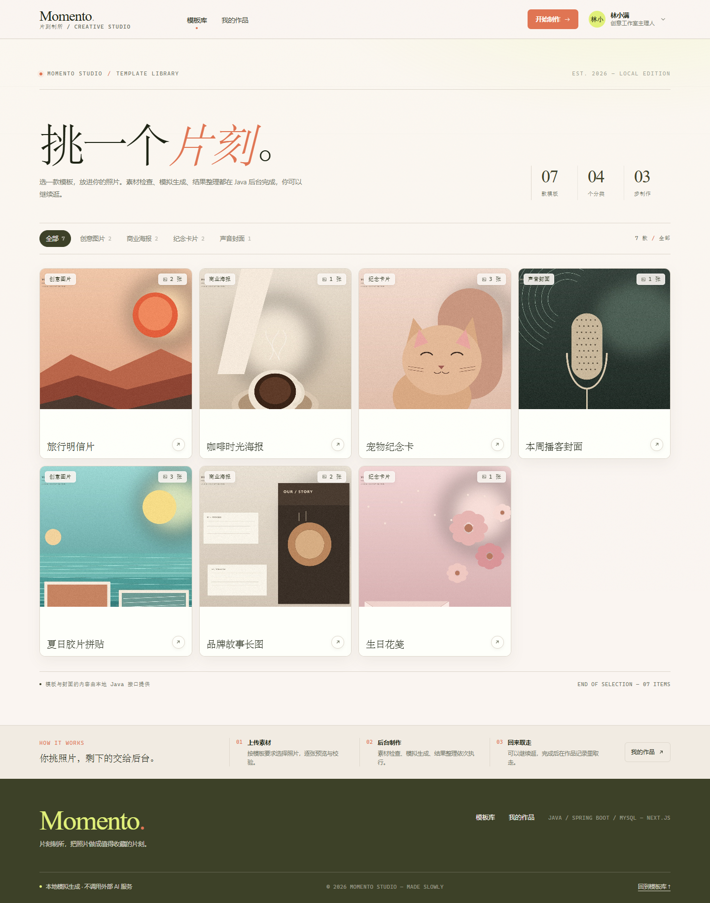

## 1. 功能一览

- **模板库**：7 个自行构造的模板、4 个分类，支持分类筛选；封面、素材数量、格式和大小限制由 Java 接口返回。模板卡使用无烘焙标题的裁切画面，标题由数据单独渲染在下方 footer 中。
- **模板详情与素材**：按模板要求生成上传位，支持选择/拖放、预览、替换、移除、上传进度、上传失败重试和本地校验；也可一键放入 5 张本地示例照片。
- **异步制作**：提交后立即返回任务 ID；Java 线程池按「素材检查 → 模拟生成 → 结果整理」三步执行。关闭页面不会中断任务。
- **任务与历史**：多任务独立展示，轮询只跟踪未结束任务；刷新后从 MySQL 恢复；成功任务可预览 1200×1500 PNG，失败任务显示阶段和原因。
- **模拟控制**：可调整三个阶段耗时、指定失败阶段和失败原因；配置在提交时快照，只影响新任务。
- **账号系统**：邮箱 + 密码注册/登录，资料修改、修改密码、退出登录；使用 BCrypt 哈希与 HttpOnly Cookie 会话，任务、素材和成品按账号隔离。
- **模板管理**：管理员可在 `/studio/templates` 新增、编辑、上传封面、上下架和安全删除模板；模板分类可直接在表单里新建，公开分类由 `template_category` 提供聚合计数。公开列表只读取上架模板，已被任务或素材引用的模板只能下架，避免历史记录失去关联。
- **匿名浏览**：未登录可浏览模板和详情；进入上传、制作和历史时引导登录，并保留 `next` 路径。
- **异常语义**：查询暂时失败只显示「状态同步中断」，不会把后台任务改成失败；恢复后继续同步。

## 2. 技术栈

| 层 | 技术 | 版本 |
|---|---|---|
| 前端 | Next.js App Router | 15.5.28 |
| 前端 | React / React DOM | 19.1.1 |
| 前端 | TypeScript | 5.9.3 |
| 前端 | TanStack Query | 5.90.2 |
| 后端 | Java | 17（`pom.xml` 固定 17） |
| 后端 | Spring Boot | 3.3.5 |
| 后端 | MyBatis Spring Boot Starter | 3.0.4 |
| 数据库 | MySQL | 8.0.44 |
| 构建 | Maven | 3.9.12 |
| 测试 | Vitest | 3.2.4 |
| 测试 | JUnit 5 + Mockito | Spring Boot 3.3.5 管理 |
| 代码质量 | ESLint 8 + `eslint-config-next` | 8.57.1 / 15.5.28 |
| CI | GitHub Actions | Node.js 22 + Temurin JDK 17 |
| 运行时 | Node.js（验证用） | 25.2.1；Docker 镜像使用 Node 22 |

样式使用 CSS Modules 和全局设计变量，未引入 UI 组件库；图标为内联 SVG。图片、封面和示例素材均由本地 Python/Pillow 脚本生成，不依赖外部图床、付费服务或公司内部服务。

### 2.1 视觉方向

前端视觉参考根目录的 `Kindsight.md`：首页借鉴了参考素材库的紧凑布局，使用浅色奶油画布、深橄榄文字、青柠强调色和珊瑚色行动按钮，以 4 列封面网格直接铺开模板；详情、账户和作品记录沿用同一套编辑式排版与白色大圆角卡片。`Kindsight.md` 是根据 getdesign.md 公开 catalog 截图和 Kindsight 落地页整理的**非官方视觉分析**（getdesign.md 当前没有提供可下载的 Kindsight DESIGN.md），仅用于提炼版式、色彩与字体方向，不包含对方品牌素材。

## 3. 目录结构

```text
FullStack/
├── .github/workflows/ci.yml # push / PR 的前后端 CI
├── compose.yaml             # 前端 + Java + MySQL 编排
├── .env.example             # Compose 非敏感配置示例
├── Kindsight.md             # 视觉分析（非官方重建，仅作设计参考）
├── backend/
│   ├── Dockerfile
│   ├── .dockerignore
│   ├── src/main/java/com/momento/studio/
│   │   ├── asset/          # 上传、文件落盘、素材校验
│   │   ├── auth/           # 注册登录、Cookie 会话、密码修改
│   │   ├── common/         # 统一错误结构与异常处理
│   │   ├── config/         # 认证过滤器、用户解析、静态资源、线程池
│   │   ├── simulation/     # 演示控制 API
│   │   ├── task/           # 建任务、状态机、异步工作流、结果合成
│   │   ├── template/       # 模板与分类
│   │   └── user/           # 账号资料与演示账号初始化
│   ├── src/main/resources/
│   │   ├── application.yml
│   │   └── db/             # schema.sql / data.sql（也是容器初始化脚本）
│   ├── src/test/java/.../task/
│   │   └── TaskWorkflowRunnerTest.java  # 后台步骤顺序 / 失败中断
│   ├── data/uploads/       # 运行期上传文件（git 忽略）
│   ├── data/results/       # 运行期成品（git 忽略）
│   └── pom.xml
├── frontend/
│   ├── Dockerfile
│   ├── .dockerignore
│   ├── .eslintrc.json
│   ├── vitest.config.ts
│   ├── app/                # 首页、登录/注册/账号、模板详情、我的片刻
│   ├── components/         # Header/AuthLayout/Modal/模板卡片/图标
│   ├── lib/                # API、认证上下文、类型、查询 hooks
│   ├── lib/task-state.test.ts           # 轮询 / 查询异常 / 多账号隔离
│   ├── public/demo/        # 7 张模板封面
│   └── public/samples/     # 5 张示例照片及缩略图
├── scripts/generate_demo_assets.py
└── docs/screenshots/
```

## 4. 快速启动

### 4.1 Docker Compose 一键启动

仓库根目录已经提供 `compose.yaml`、前后端 `Dockerfile`、`.env.example`。在装有 Docker Engine 24+ 与 Docker Compose v2 的机器上，不需要预装 JDK、Maven、Node.js 或 MySQL：

```bash
docker compose up --build
```

打开 <http://localhost:3000>（若修改了 `FRONTEND_PORT`，使用对应端口）。首次启动会编译前后端镜像、创建 MySQL 数据卷，并由 MySQL 初始化脚本写入 2 个演示账号、7 个模板和 4 个分类；Java 启动时的 `spring.sql.init` 也会执行同一组幂等脚本。演示账号为 `lin@momento.studio`（林小满）和 `chen@momento.studio`（陈一舟），密码均为 `momento123`。容器首次启动时个人历史为空，登录后完成一次制作即可看到记录；本工作区本机运行的数据库则保留了 4 条策展演示记录。首次构建需要能访问 Docker Hub、Maven Central 和 npm registry。加上 `-d` 可后台运行，用 `docker compose ps` 查看状态，用 `docker compose logs -f backend frontend` 查看日志。

| 服务 | 容器内端口 | 宿主机端口 | 说明 |
|---|---|---|---|
| `frontend` | 3000 | `${FRONTEND_PORT:-3000}` | Next.js 生产构建，服务端按 `/api`、`/uploads`、`/results` 代理 Java |
| `backend` | 8080 | `${BACKEND_PORT:-8080}` | Spring Boot + MyBatis，等待 MySQL healthy 后启动 |
| `mysql` | 3306 | 不发布 | `mysql:8.0`，初始化 SQL 来自 `backend/src/main/resources/db/` |

持久化使用两个命名卷：`mysql-data` 保存数据库；`app-data` 挂到 Java 容器的 `/app/data`，保存上传文件和结果图。前端在 Docker 内部使用 `http://backend:8080`，浏览器只访问 3000，因此不依赖 CORS。

#### 可选配置

所有配置都有本地演示默认值，直接执行 `docker compose up --build` 也能启动。要调整数据库账号、端口或模拟耗时：

```bash
cp .env.example .env
# 编辑 .env
docker compose up --build
```

`.env.example` 中的账号和密码是**仅用于本地演示**的示例值，不要用于公网部署。端口冲突时（例如本机开发服务已占用 3000/8080），修改 `.env` 里的 `FRONTEND_PORT` / `BACKEND_PORT` 后重新执行，或先停止本机服务；容器之间仍使用 3000 / 8080。

#### 修改 Compose 文件名

`docker compose up --build` 默认读取根目录的 `compose.yaml`，等价命令是：

```bash
docker compose -f compose.yaml up --build
```

如果复制成自定义文件名：

```bash
cp compose.yaml compose.local.yaml
docker compose -f compose.local.yaml up --build
```

如果把它移到 `deploy/` 等子目录，建议显式指定项目目录，保证 `build.context` 和 MySQL 初始化 SQL 的相对路径仍以仓库根目录为基准：

```bash
docker compose --project-directory . -f deploy/compose.local.yaml up --build
```

也可以搭配自定义环境文件：

```bash
docker compose --env-file .env.local -f compose.local.yaml up --build
```

#### 初始化、重置与排障

- 初始化 SQL 只在 MySQL 数据卷为空时自动执行；要重新初始化，先 `docker compose down -v`，再 `docker compose up --build`。`-v` 会同时删除数据库、上传素材和结果图，请确认不需要保留。
- 只停止容器、保留数据：`docker compose down`。
- 进入 MySQL 检查种子数据：`docker compose exec mysql sh -lc 'mysql -u"$MYSQL_USER" -p"$MYSQL_PASSWORD" "$MYSQL_DATABASE"'`。
- 后端健康检查：`docker compose ps`，或访问宿主机映射的 `BACKEND_PORT`（默认 8080）下的 `/api/templates`。前端健康检查失败时先看 `docker compose logs backend`。
- 如果修改了 `JAVA_API_ORIGIN`，需要重新构建前端镜像，因为 Next 的 rewrites 在构建阶段写入镜像：`docker compose build frontend && docker compose up -d`。
- 如果修改了 `schema.sql` / `data.sql` 而想重新初始化，同样需要按上面的方式删除数据卷后重启；已有的 MySQL 卷不会自动重放初始化脚本。

### 4.2 本机运行（不使用 Docker）

#### 4.2.1 前置条件

- JDK 17（`java -version` 和 Maven 使用的 Java 均应为 17）
- Maven 3.9+
- Node.js 18.18+（本项目在 Node 25.2.1 验证）
- MySQL 8.x，具备创建数据库/表的权限

#### 4.2.2 准备数据库

```sql
CREATE DATABASE IF NOT EXISTS momento_studio
  CHARACTER SET utf8mb4 COLLATE utf8mb4_unicode_ci;
```

也可以不手动创建：JDBC URL 带 `createDatabaseIfNotExist=true`，账号有建库权限时会自动创建。首次启动会自动执行 `schema.sql` 和 `data.sql`，写入 2 个演示账号、7 个模板及 4 个分类；Java 的 `DemoAccountInitializer` 会为两个历史演示账号补上登录邮箱和 BCrypt 密码（`lin@momento.studio` / `chen@momento.studio`，密码 `momento123`），不覆盖已修改过的密码。

如果需要清空演示数据，删除数据库后重启后端即可重新初始化；上传文件和成品位于 `backend/data/`，也可一并清空。

#### 4.2.3 启动 Java 后端

```bash
cd backend
mvn -q -DskipTests package

# 使用 JDK 17 的 java 执行；按实际数据库连接修改环境变量
DB_PORT=3306 \
DB_USERNAME=root \
DB_PASSWORD=your-password \
java -jar target/momento-studio-api-1.0.0.jar
```

Windows PowerShell：

```powershell
cd backend
mvn -q -DskipTests package
$env:DB_PORT="3306"
$env:DB_USERNAME="root"
$env:DB_PASSWORD="your-password"
& "$env:JAVA_HOME\bin\java.exe" -jar target/momento-studio-api-1.0.0.jar
```

后端默认监听 `http://localhost:8080`。请从 `backend/` 目录启动，这样默认的 `./data/uploads`、`./data/results` 会落在 `backend/data/` 下。

本工作区已有一个隔离的 MySQL 实例运行在 `127.0.0.1:3307`（root 空密码），因此本地验证命令为：

```bash
cd backend
DB_PORT=3307 java -jar target/momento-studio-api-1.0.0.jar
```

#### 4.2.4 启动 Next.js 前端

```bash
cd frontend
npm ci
npm run dev
```

打开 <http://localhost:3000>。开发服务器通过 `next.config.js` 的 rewrites 将 `/api/*`、`/uploads/*`、`/results/*` 代理到 Java，浏览器侧不产生跨域请求。

若 Java 不在 `http://127.0.0.1:8080`，启动前设置：

```bash
JAVA_API_ORIGIN=http://127.0.0.1:8081 npm run dev
```

生产构建：

```bash
cd frontend
npm run typecheck
npm run build
npm run start
```

#### 4.2.5 后端可配置项

| 环境变量 | 默认值 | 说明 |
|---|---|---|
| `SERVER_PORT` | `8080` | Java 端口 |
| `DB_HOST` / `DB_PORT` / `DB_NAME` | `127.0.0.1` / `3306` / `momento_studio` | MySQL 连接 |
| `DB_USERNAME` / `DB_PASSWORD` | `root` / 空 | 数据库账号 |
| `APP_UPLOAD_DIR` | `./data/uploads` | 上传文件目录 |
| `APP_RESULT_DIR` | `./data/results` | 成品图目录 |
| `APP_DEV_API_ENABLED` | `true` | 是否开放 `/api/dev/simulation` |
| `APP_AUTH_COOKIE_NAME` | `momento_session` | 登录会话 Cookie 名 |
| `APP_AUTH_COOKIE_SECURE` | `false` | 是否只允许 HTTPS 发送 Cookie；公网部署应设为 `true` |
| `APP_SESSION_DAYS` | `30` | 登录会话有效天数 |
| `SIM_ASSET_CHECK_DELAY_MS` | `1800` | 启动时三阶段默认耗时 |
| `SIM_GENERATE_DELAY_MS` | `4200` | 同上 |
| `SIM_FINALIZE_DELAY_MS` | `1500` | 同上 |
| `WORKFLOW_CORE_POOL_SIZE` | `2` | 任务工作线程 core 数 |
| `WORKFLOW_MAX_POOL_SIZE` | `4` | 任务工作线程 max 数 |
| `WORKFLOW_QUEUE_CAPACITY` | `100` | 队列长度 |

前端代理地址：`JAVA_API_ORIGIN`（默认 `http://127.0.0.1:8080`）。

### 4.3 检查、测试与 CI

本地执行与 CI 相同的检查：

```bash
# 后端：工作流单测 + 构建
cd backend
mvn -B test
mvn -B -DskipTests package

# 前端：Lint + 类型 + 单测 + 生产构建
cd ../frontend
npm ci
npm run lint
npm run typecheck
npm run test
npm run build
```

- 后端测试位于 `backend/src/test/java/.../task/TaskWorkflowRunnerTest.java`，覆盖三阶段顺序、指定步骤失败后中断、素材数量不合法和任务抢占失败。
- 前端测试位于 `frontend/lib/task-state.test.ts`，覆盖查询 Key 的账号隔离、未完成任务轮询与终态停止，以及查询异常、空数据和失败任务的状态区分。
- 前端 lockfile 显式锁定 `@emnapi/core` / `@emnapi/runtime`，避免 npm 对可选 WASM peer 的解析差异导致 `npm ci` 在 Linux CI 中校验失败。
- `.github/workflows/ci.yml` 在 push 到 `main` 和 PR 时并行执行前端 lint/typecheck/test/build 与后端 test/package；任一步失败会阻止通过。2026-10-29 的最新实际运行 [40880624411](https://github.com/Ha1ifax/XiaoYingTest-FS/actions/runs/40880624411) 已通过：前端 install/lint/typecheck/test/build 与后端 test/package 全部成功。
- 提交前最少执行一次完整命令；生产环境只部署通过 `mvn package` 和 `npm run build` 的产物。

## 5. 页面与演示路径

### 5.1 模板列表

首页是浅色的素材画廊：顶部为紧凑标题、动态统计和分类 tab，下方直接铺开模板卡网格（桌面 4 列、移动 2 列），流程说明压缩成底部一条窄带。卡片上方使用去除海报内标题的裁切画面，标题和箭头放在独立的奶油色 footer 中，避免依赖图片里的烘焙文字。页面沿用 Kindsight 的奶油、深橄榄、青柠与珊瑚体系，只借鉴了参考图的布局结构，没有改成深色主题。分类计数和模板卡片都来自 `GET /api/templates`、`GET /api/templates/categories`，不是前端写死；点击卡片进入详情。

### 5.2 模板详情与上传

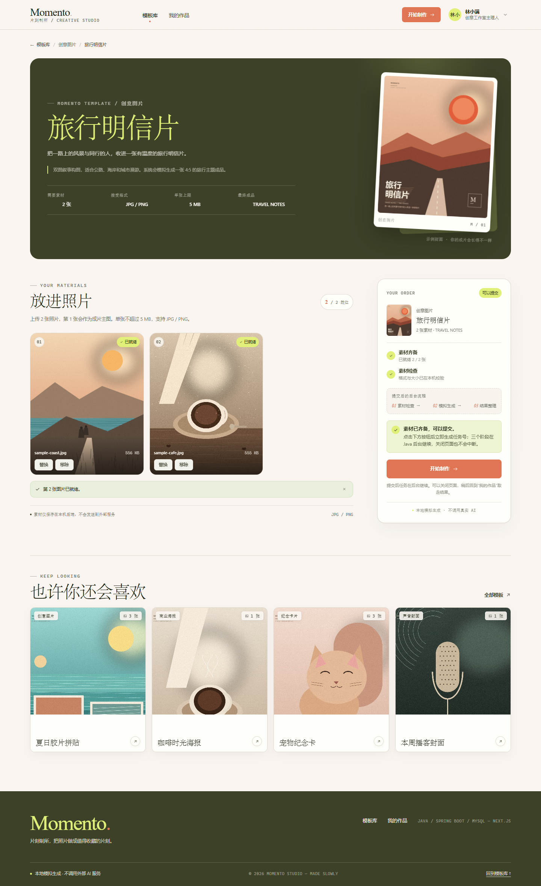

- 页面展示模板标题、描述、示例封面、素材要求（张数、格式、单张上限、结果标签）。
- 每个上传位都可点击选择、拖入文件、预览、替换和移除；上传中显示文件本地预览和进度，失败显示原因并允许重试。
- 上传位下方提供 5 张本地示例照片，点击会填入第一个空位，便于没有本地图片时快速演示。
- 前端先校验类型、大小、数量；服务端再次校验模板、数量、用户归属、文件头、可解码性和大小。
- 素材全部就绪前提交按钮为「还差 N 张图片」并禁用；全部就绪时，制作单内出现「素材已齐备，可以提交。」引导，按钮变为「开始制作」。提交请求期间按钮显示「正在受理任务……」，同时禁用交互，避免重复创建任务。
- 页面底部提供「也许你还会喜欢」推荐区，优先展示同分类模板，最多 4 张，方便继续浏览或换一款制作。
- 小屏（≤680px）增加固定的制作快捷条：显示素材进度，登录用户可直接跳到右侧制作单，未登录进入登录页；滚动接近页脚时自动隐藏，避免遮挡推荐和页脚。

### 5.3 提交与历史

提交成功后跳转 `/creations?new=<taskId>`，页面显示受理横幅并高亮对应任务。任务状态从 Java 查询，不由前端计时器伪造：

| 状态 | 含义 |
|---|---|
| `QUEUED` | 已受理，等待工作线程 |
| `PROCESSING` | 正在执行某个阶段 |
| `SUCCEEDED` | 三阶段完成，有 `resultUrl` |
| `FAILED` | 某阶段失败，保存失败阶段和原因 |

「我的片刻」展示创建时间、状态、当前阶段、三步轨道、失败原因和成品预览。所有用户的历史都持久化在 MySQL，刷新后重新查询；未完成的任务继续轮询，全部结束后停止。

### 5.4 演示控制

历史页右上角的「演示控制」可调整：

- 三个阶段等待时间（秒；后端存储毫秒，范围 0–120 秒）
- 失败注入阶段：不注入 / 素材检查 / 模拟生成 / 结果整理
- 失败原因（最多 300 字）

保存后仅影响**新提交**的任务，因为任务创建时会把当时的模拟配置快照写入 `creation_task.simulation_config`。已受理任务不会被后续保存修改。

### 5.5 注册、登录与账号

- `/register` 创建账号：显示名 2–40 字、邮箱、密码 8–64 字；注册成功即建立会话并跳回 `next` 路径。
- `/login` 使用邮箱和密码登录；页面提供两个演示账号的一键填充，方便直接查看已有历史。
- `/account` 是单页账户设置：顶部身份卡与「编辑资料」，下方为只读邮箱、密码行与「修改」；资料编辑/改密按需展开，并提供「我的作品 / 账号安全 / 隐私与数据」快捷入口。管理员还会看到「模板管理」。底部可退出登录，改密后其他设备的会话会被撤销，当前会话保留。
- 未登录可以浏览模板；详情页的上传区和历史页会显示登录引导，登录后回到原路径。
- 顶栏右侧显示登录入口或账号菜单（我的作品、账号设置、模板管理、退出登录；模板管理仅管理员可见）。登录、登出会取消当前任务查询并清理任务缓存，避免上一个账号的旧响应覆盖新账号。
- 账户页的「隐私与数据」会说明素材、账号和模拟生成数据分别存放在哪里；演示站不提供删除账号，避免误删已有制作记录。

演示账号：

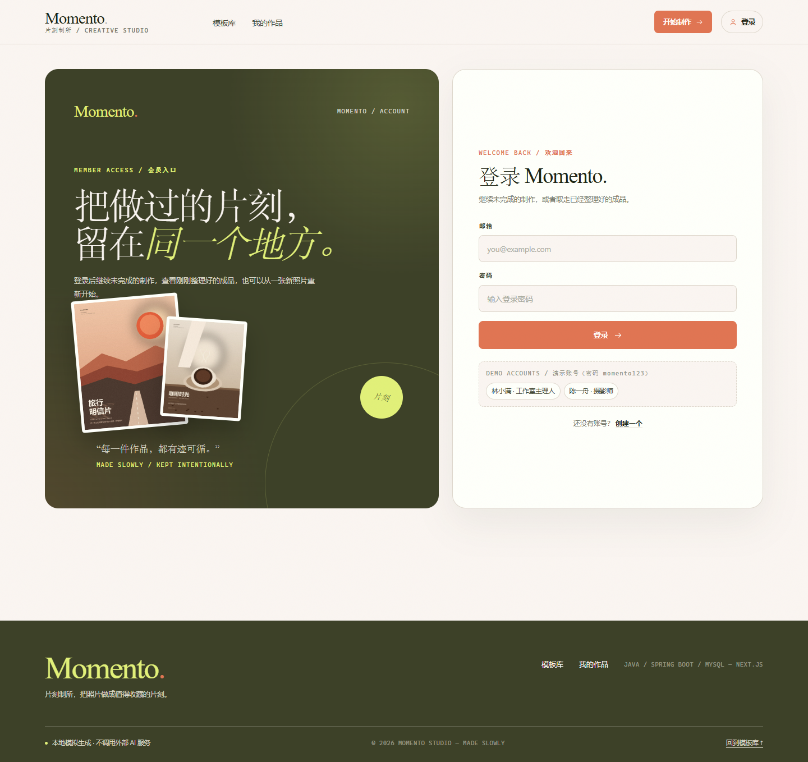

| 账号 | 邮箱 | 密码 | 已有记录 |
|---|---|---|---|
| 林小满 | `lin@momento.studio` | `momento123` | 3 条：明信片成功、咖啡 FINALIZE 失败、宠物成功 |
| 陈一舟 | `chen@momento.studio` | `momento123` | 1 条品牌故事成功 |

> 这两个账号来自早期演示数据迁移，密码只用于本地演示，并带有 `is_admin = true`，可进入模板管理。注册的新账号角色为「独立创作者」，默认没有模板管理权限。

### 5.6 模板库管理（管理员）

演示账号登录后，可从顶栏账号菜单或账户设置的「模板管理」进入 `/studio/templates`。页面只对 `is_admin = true` 的账号开放，普通账号访问会看到受限说明。

- **列表**：默认同时显示上架与已下架模板，支持按状态筛选和按标题、分类、ID 搜索；每行显示封面、素材要求、任务/素材引用数和更新时间。
- **新增 / 编辑**：标题、分类、描述、4:5 封面、所需照片数、格式、单图上限、强调色、成品标签、版式说明和排序。封面在表单内直接上传到 `backend/data/uploads/covers`，保存的是本地 `/uploads/covers/...` 地址。
- **分类**：分类来自独立的 `template_category` 表。表单里的「新建分类」可以当场创建并自动选中，保存模板时会校验分类必须存在；公开分类只显示仍有上架模板的分类，空分类不会出现在首页。
- **上下架**：下架后模板从公开列表和分类统计中消失，已创建的历史任务仍会正常显示模板信息；重新上架即可恢复。
- **删除保护**：只有 `taskCount = 0 && assetCount = 0` 的模板可以永久删除。已有任务或素材引用时接口返回 409，界面引导先下架。
- **持久化**：模板改动写入 MySQL。种子数据使用 `INSERT IGNORE`，服务重启不会把管理员编辑过的标题、封面或状态覆盖回初始值。
- **权限边界**：这是演示站的布尔管理员标记，不是细粒度角色系统；生产环境仍需补充操作审计、权限分级和封面文件的生命周期清理。

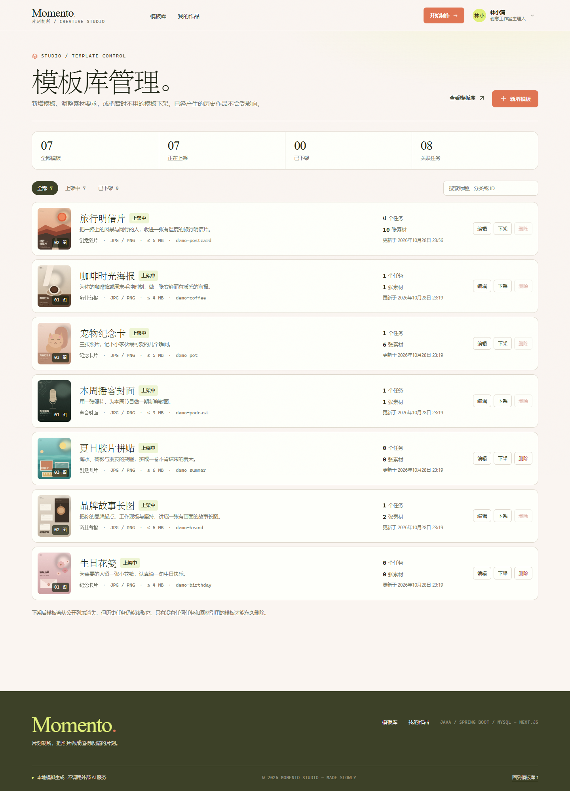

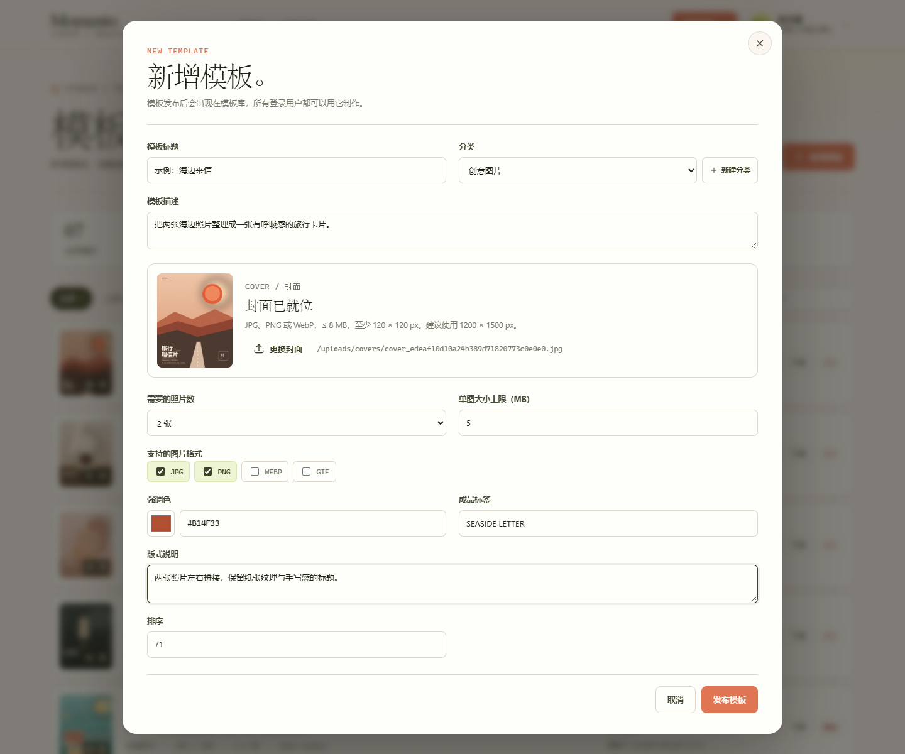

## 6. 用户身份与个人记录方案

### 6.1 认证与会话

这是可本地完整运行的账号系统，不是生产级身份平台：

1. `app_user` 保存 `email`（唯一）、`password_hash`、显示名、角色和时间。密码用 BCrypt（strength 10）哈希，任何接口都不返回哈希。
2. 登录成功后生成 32 字节随机 token，浏览器只保存原值到 HttpOnly Cookie `momento_session`；数据库 `auth_session` 只存 token 的 SHA-256 哈希、用户、过期时间和最后访问时间。
3. Cookie 默认 `HttpOnly`、`SameSite=Lax`、`Path=/`、30 天有效；本地 HTTP 下 `Secure=false`，公网部署必须通过 `APP_AUTH_COOKIE_SECURE=true` 打开。
4. `AuthSessionFilter` 在每个请求读取 Cookie 并把当前用户放入 request attribute；`@CurrentUser` 从其中取用户。需要登录的接口在没有有效会话时返回 `401`。
5. 注册时处理邮箱唯一冲突；密码检查 UTF-8 字节长度不超过 BCrypt 的 72 字节上限。登录失败统一返回「邮箱或密码不正确」，不暴露邮箱是否存在。
6. 退出登录删除当前会话并过期 Cookie；修改密码删除其他会话，仅保留当前 token。`GET /api/auth/me` 在未登录时返回 200 + `{user:null}`（而不是 401），方便前端恢复登录态。

### 6.2 数据隔离

- `uploaded_asset` 和 `creation_task` 都有 `user_id`；上传、建任务、任务列表、任务详情均按当前登录账号过滤或校验归属。
- 提交任务时校验每个素材属于当前账号、属于同一模板且文件仍可读；跨账号使用素材会被拒绝。
- 查询 key 包含当前用户 ID；登录、登出和改密后会取消查询并清理缓存，页面按账号重新挂载。刷新时通过 `/api/auth/me` + Java/MySQL 恢复。
- 未登录访问 `/creations`、`/account` 会看到 `AuthRequired` 引导；模板详情可以匿名查看，但上传/提交入口要求登录。

### 6.3 演示与生产边界

- 演示账号迁移逻辑在 `DemoAccountInitializer`，仅为两个旧 `u_lin` / `u_chen` 补邮箱和密码，不覆盖用户改过的密码。
- 生产化还需要：HTTPS + `Secure` Cookie、邮件验证、密码重置、登录/注册限流、CSRF 防护（或严格 SameSite + 自定义头策略）、会话轮换与审计、账号注销/数据导出。
- 当前没有邮箱验证、忘记密码、第三方登录、MFA 和账号删除；时间与展示均使用 `Asia/Shanghai`。

## 7. 异步处理设计

### 7.1 任务受理

`POST /api/tasks` 在事务中完成：

1. 校验模板存在、素材 ID 去重、数量等于模板要求；
2. 校验素材属于当前用户、模板匹配、文件可读；
3. 插入 `creation_task`（`QUEUED`）、`task_asset`（保留上传顺序）和 3 条 `PENDING` 的 `task_step`；
4. 将当前模拟参数序列化到任务行；
5. 发布 `TaskSubmittedEvent`。

事务提交后，`@TransactionalEventListener(AFTER_COMMIT)` 把任务交给 `taskWorkflowExecutor`。控制器返回 HTTP **202** 和任务对象，不等待制作完成。

### 7.2 工作流

工作线程先执行条件更新 `QUEUED → PROCESSING`（`claim`），然后依次执行：

```text
ASSET_CHECK（素材检查）
      ↓
GENERATE（模拟生成）
      ↓
FINALIZE（结果整理：Java2D 合成 PNG）
```

- 每个阶段开始：写 `current_stage`，把对应步骤设为 `RUNNING`；
- 每个阶段按任务快照等待指定毫秒数；
- 成功后把该步骤设为 `SUCCEEDED`，继续下一阶段；
- 若配置的失败阶段命中，抛出阶段失败；未执行步骤保持/变为 `SKIPPED`，任务变为 `FAILED`，写入 `failure_stage` 和 `failure_reason`；
- 三阶段全部成功后，`FINALIZE` 生成 `/results/result_<taskId>.png`，任务变为 `SUCCEEDED`。

状态更新使用条件 SQL（只允许合法前置状态），避免已结束任务被查询或重复执行改回处理中。所有 GET 查询只读取数据库，不会推动任务。

### 7.3 并发与持久化

- `ThreadPoolTaskExecutor`：core 2、max 4、队列 100，支持多个任务排队或并行。
- 任务状态、步骤、素材关联、结果地址都在 MySQL 中；页面关闭、刷新、换标签后仍继续执行。
- 结果图片写入后端本地目录，由 `/results/**` 静态映射访问。
- 这是单 JVM 演示实现：投递事件不是持久化消息队列。若在事务提交后、线程池接收前进程崩溃，任务可能停留在 `QUEUED`。生产版应使用 MQ/持久化 Outbox + 多实例消费者；README 第 12 节明确列出该边界。

### 7.4 状态模型

```text
task.status:        QUEUED → PROCESSING → SUCCEEDED
                                  └────→ FAILED
task.current_stage: ASSET_CHECK → GENERATE → FINALIZE（可为空）
task_step.status:   PENDING → RUNNING → SUCCEEDED
                                  └────→ FAILED
                   PENDING → SKIPPED（失败后的后续步骤）
```

`current_stage` 与整体 `status` 分开设计；失败时保留失败阶段，成功时保留成品 URL。

## 8. API 摘要

除模板读取、登录、注册和 `/api/auth/me` 外，接口都需要有效的 `momento_session` Cookie（HttpOnly，由登录/注册的 `Set-Cookie` 写入）。浏览器端统一使用 `credentials: "include"`，不再有演示身份请求头。

| 方法 | 路径 | 说明 |
|---|---|---|
| POST | `/api/auth/register` | `{displayName,email,password}`；201 + 会话 Cookie，重复邮箱 409 |
| POST | `/api/auth/login` | `{email,password}`；200 + 会话 Cookie |
| POST | `/api/auth/logout` | 删除当前会话；204，幂等 |
| GET | `/api/auth/me` | `{user: AuthUser|null}`；用于恢复登录态 |
| PATCH | `/api/auth/profile` | `{displayName}`；返回更新后的 user |
| POST | `/api/auth/password` | `{currentPassword,newPassword}`；204，撤销其他会话 |
| GET | `/api/templates?category=创意图片` | 模板列表，category 可省略；公开 |
| GET | `/api/templates/categories` | 分类与模板数量；公开 |
| GET | `/api/templates/{id}` | 模板详情，不存在返回 404；公开 |
| GET | `/api/admin/templates` | 管理列表，含已下架模板和任务/素材引用数；仅管理员 |
| POST | `/api/admin/templates` | 创建模板；201，仅管理员 |
| PUT | `/api/admin/templates/{id}` | 更新模板字段；仅管理员 |
| PATCH | `/api/admin/templates/{id}/active` | 上架/下架；仅管理员 |
| DELETE | `/api/admin/templates/{id}` | 永久删除；有引用时 409；仅管理员 |
| GET | `/api/admin/templates/categories` | 全部分类（含空分类）及模板数；仅管理员 |
| POST | `/api/admin/templates/categories` | `{name}`；创建分类，重名 409；仅管理员 |
| DELETE | `/api/admin/templates/categories/{id}` | 删除空分类；仍有模板时 409；仅管理员 |
| POST | `/api/admin/templates/covers` | multipart `file`，上传封面；201，仅管理员 |
| POST | `/api/uploads?templateId={id}` | multipart `file`；返回 201，需登录 |
| DELETE | `/api/uploads/{assetId}` | 删除未被任务引用的素材；被引用返回 409，需登录 |
| POST | `/api/tasks` | `{ "templateId": "...", "assetIds": ["..."] }`；返回 202，需登录 |
| GET | `/api/tasks` | 当前账号历史任务，按创建时间倒序，需登录 |
| GET | `/api/tasks/{taskId}` | 当前账号单个任务，需登录 |
| GET | `/api/dev/simulation` | 当前模拟配置，需登录 |
| PUT | `/api/dev/simulation` | 更新模拟配置，需登录 |

错误统一返回：

```json
{
  "code": "VALIDATION_FAILED",
  "message": "可读的中文错误信息",
  "timestamp": "2026-10-28T06:20:00Z"
}
```

### 8.1 可重复触发指定阶段失败

推荐直接用页面上的「演示控制」，也可以先登录拿 Cookie，再调用开发接口：

```bash
# 用演示账号登录，把会话 Cookie 存到 cookie.txt
curl -c cookie.txt -X POST http://localhost:8080/api/auth/login \
  -H "Content-Type: application/json" \
  -d '{"email":"lin@momento.studio","password":"momento123"}'

# 让下一次提交在“模拟生成”阶段失败，并把三个阶段的耗时调短
curl -b cookie.txt -X PUT http://localhost:8080/api/dev/simulation \
  -H "Content-Type: application/json" \
  -d '{
    "assetCheckDelayMs": 800,
    "generateDelayMs": 1500,
    "finalizeDelayMs": 600,
    "failureStage": "GENERATE",
    "failureMessage": "演示注入：模拟生成没有取得有效画面。"
  }'
```

- `failureStage` 可选：`ASSET_CHECK`、`GENERATE`、`FINALIZE`；传 `NONE` 或空字符串表示不注入失败。
- 失败后立刻停止后续阶段，未执行步骤标记为 `SKIPPED`，历史记录显示失败阶段和原因。
- 不需要随机失败；失败任务不会自动重试。恢复成功只需再次 PUT 一个 `failureStage` 为空的配置，然后提交新任务。
- 若不希望演示控制暴露，可设置 `APP_DEV_API_ENABLED=false` 重启后端，接口返回 404。

> 为了便于观察「等待中 → 处理中 → 完成」，可以先把三个耗时设为 `10000 / 20000 / 5000`，连续提交两个任务，然后刷新或切换页面。任务在后台继续运行。

## 9. 前端异步状态管理

- TanStack Query 管理登录态、模板、任务、模拟配置；任务查询 key 包含当前用户 ID，避免身份串数据。
- `AuthProvider` 启动时请求 `/api/auth/me`；登录、注册、登出和改密后取消正在进行的查询、清理任务缓存并更新当前用户。`AuthSessionFilter` 失效时 API 返回 401，前端不再把 401 误当成任务失败。
- 任务列表的 `refetchInterval` 仅在存在 `QUEUED`/`PROCESSING` 时返回 1200ms；全部终态后返回 `false`，侧栏同时显示「自动轮询已停止」。
- 查询失败但有历史缓存时，显示「状态同步暂时中断，记录仍在这里」，保留原任务状态；不会在本地把任务改成 FAILED。用户可点「恢复查询」或「立即刷新」。
- 提交成功后先 `setQueryData` 种子任务，再 invalidate；跳转历史页立刻有内容，不依赖下一次轮询。
- 上传使用 `XMLHttpRequest` 获得真实进度和 AbortSignal。替换图片时先保留旧素材，上传成功后才删除旧素材；失败则回滚到旧图。
- 离开详情页会 abort 进行中的上传并回收 `blob:` 预览；登出或换账号会 `cancelQueries` 并清理缓存，避免旧账号的请求响应覆盖新页面数据。
- 页面分别呈现：素材上传中、提交请求中、任务等待、任务处理中、任务成功、任务失败、查询异常，以及登录失效/未登录引导。

## 10. 模板、素材与结果图

- 模板数据：`backend/src/main/resources/db/data.sql`，7 个模板、4 个分类，图片需求分别为 1–3 张。
- 封面：`frontend/public/demo/*.jpg`，1200×1500，本地程序生成。
- 卡片图：`frontend/public/demo/cards/*.jpg`，960×800；由 `scripts/generate_card_covers.py` 从标题-free 画面裁切生成，避免海报内标题与界面标题重复。
- 示例照片：`frontend/public/samples/*.jpg`，5 张，另有 `thumbs/` 缩略图用于上传位。
- 生成脚本：`scripts/generate_demo_assets.py`，使用 Pillow + NumPy，不下载外部素材；可重复运行。脚本里包含配色、构图和文字排版，并保留高分辨率输出。
- 结果合成：`backend/.../task/ResultComposer.java`，1200×1500 PNG，根据 1/2/3 张素材使用不同拼贴布局，叠加模板标题、分类、结果标签、日期和页脚。它是固定排版生成，不是 AI 模型。

## 11. 验证记录

验证环境：Windows、JDK 17 + Maven 3.9.12、Node 25.2.1、MySQL 8.0.44；前端以生产构建 `next start` 运行，后端为打包后的 Spring Boot jar。

| 检查项 | 结果 |
|---|---|
| `mvn -B test` | 通过：4 个后台工作流测试，0 failures |
| `mvn -q -DskipTests package` | 通过 |
| `npm run lint` | 通过（仅 `next/image` 与 ref cleanup 的 warning，不阻断 CI） |
| `npm run test` | 通过：7 个前端状态/轮询测试 |
| `npm run typecheck` | 通过 |
| `npm run build` | 通过；构建后以 `next start` 运行生产产物 |
| GitHub Actions | 通过：run [40880624411](https://github.com/Ha1ifax/XiaoYingTest-FS/actions/runs/40880624411)；前端 install/lint/typecheck/test/build、后端 test/package 均成功 |
| 模板列表/分类/详情 API | 7 个模板、4 个分类；不存在模板 404 |
| 图片上传 | 合法 JPEG/PNG 201；伪装 MIME、超大小、非图片被拒 |
| 注册/登录 | 注册成功返回 201 + `Set-Cookie`；错误密码 401；重复邮箱 409；未登录访问任务接口 401 |
| 账号设置 | 修改显示名生效；改密后旧密码 401、新密码可登录，其他会话被撤销、当前会话保留 |
| 登出与恢复 | 登出 204 并清 Cookie；刷新页面通过 `/api/auth/me` 恢复登录态；未登录进入个人页显示登录引导 |
| 账号闭环 | 新账号注册 → 空历史 → 示例素材上传 → 提交 202 → 三阶段成功 → 成品预览；改显示名、改密、退出、新密码重新登录全部通过，测试数据已清理 |
| 账号隔离 | 林小满/陈一舟登录后各自只看到自己的历史；跨账号使用素材被拒 |
| 任务受理 | 返回 202；任务立即出现在历史页 |
| 三阶段后台执行 | 成功任务 steps 全部 `SUCCEEDED`，生成 1200×1500 PNG |
| 结果合成 | 1 / 2 / 3 张素材均能生成对应拼贴布局 |
| 指定阶段失败 | `FINALIZE` 失败：前两步成功、第三步 FAILED；`GENERATE` 失败：后续 FINALIZE 为 SKIPPED |
| 查询异常恢复 | 拦截任务查询后保留“处理中”，不误判失败；恢复后可继续同步 |
| 轮询生命周期 | 全部终态后 6 秒内查询次数不再增加 |
| 多任务隔离 | 多任务状态/阶段/结果互不串扰；连续提交后各自轮询和停止 |
| 重复提交 | 提交中按钮 disabled，强制重复点击只产生 1 次 POST |
| 刷新恢复 | 刷新后从 Java/MySQL 恢复历史并继续跟踪未完成任务 |
| 首页画廊 | 浅色素材画廊 7 张封面 4+3 排列，分类筛选 7→1→7；接口 503 时显示错误面板，解除后可重试恢复；无 console error |
| 模板卡标题 | 卡片画面使用 title-free 裁图，标题由数据在 footer 渲染；桌面 4 列、移动 2 列，1440px/390px 无横向溢出 |
| 提交前引导 | 两张素材就绪后显示“素材已齐备，可以提交。”，按钮切换为“开始制作”；`aria-describedby` 只引用可见提示 |
| 模板管理 | 管理员创建/编辑/上下架/删除模板通过；封面 multipart 上传返回本地 `/uploads/covers/...`；被 4 个任务引用的模板删除返回 409，未被引用的临时模板可删除 |
| 模板分类 | 在模板表单内新建“婚礼纪实”后自动选中；分类重名和删除仍有模板的分类均返回 409，删除空分类返回 204；公开分类保持 4 个 |
| 模板权限 | 非管理员调用 `/api/admin/templates` 返回 403；访问 `/studio/templates` 显示受限说明；普通用户仍可浏览公开模板 |
| 字号复核 | 首页、详情、历史、账号、模板管理在 1440px/390px 检查，无横向溢出；较小说明文字统一上调 1–2px |
| 视觉改版回归 | 参考 Kindsight 的深橄榄/青柠/珊瑚视觉在 1440px、390px 下完成详情、历史、结果与演示控制截图；首页按参考图改为浅色素材画廊；改版后重新走通上传、提交、轮询和成品预览 |
| 响应式 | 1440px 与 390px 截图无横向溢出，移动端可完成浏览/上传/查看 |
| 详情优化 | 底部“也许你还会喜欢”展示 4 个相关模板；390px 固定制作条顶部可见、接近页脚自动隐藏，相关卡片为 2 列，无 console error |
| 生产构建 | `next build` 通过，`next start` 在 3000 端口实测首页、模板、登录、账号、历史、结果图和 `/api` 代理均正常，登录/登出 Cookie 链路通过 |
| Docker 配置 | `compose.yaml`、Dockerfile、初始化挂载和端口拓扑静态检查通过；初始化 SQL 已在空库实测导入 2 用户/7 模板/4 分类及 `auth_session` 表，并以全新数据库启动 Java 验证自动建表/seed；当前验证环境未安装 Docker，未执行镜像构建 |

自动化测试负责可重复的关键状态断言，Playwright（系统 Edge）+ 实际 Java/MySQL 服务负责端到端验收；两者不是替代关系。前端测试文件不启动 HTTP 服务，因此不依赖数据库或后端进程。

## 12. 实际投入

从首次需求到本次验收（2026-10-28 13:40 至 2026-10-29 22:40，Asia/Shanghai）跨约 33 小时；其中包含等待构建、后台任务和人工查看的时间。以下为按会话内容复盘的有效工作量估算，并非精确计时：

| 阶段 | 主要内容 | 估算有效投入 |
|---|---|---:|
| 需求梳理与架构 | 技术选型、API/表结构、异步执行与身份方案 | 1.5 小时 |
| Java 后端 | 模板/素材/任务、工作流、结果合成、账号与权限 | 3.5 小时 |
| Next.js 前端 | 模板库/详情/历史/账号/管理页、异步状态与轮询 | 4 小时 |
| 视觉与素材 | Kindsight 方向、本地封面/样片、响应式与字号调整 | 1.5 小时 |
| 测试、CI 与文档 | 单测、Lint、Compose、README、截图和端到端验收 | 2 小时 |
| 后续设计迭代 | 详情相关推荐、移动快捷条、模板卡标题解耦、提交前引导 | 2 小时 |
| 合计 | 含 AI 代理的编码与测试执行；人工负责需求、取舍和验收 | **约 14.5 小时** |

协作方式：AI 编码代理承担脚手架、页面/接口实现、测试和文档的大部分执行工作；人工负责目标设定、视觉方向、关键取舍和结果验收。所有 AI 产出都经过本地命令、接口调用或 Playwright 截图复核后才计入完成；本 README 只把实际运行过的 CI 写为已验证，未安装 Docker 的环境不把镜像构建写成已验证。

## 13. AI 使用工作流与外部来源

**AI 工作流**

1. 将题目要求拆成 R-01–R-14 验收项，先确认技术栈、状态机、身份和持久化边界。
2. 以可运行的最小闭环推进：数据/API → 异步工作流 → 前端状态 → 账号/模板管理。
3. 每轮修改后用 `typecheck`、单测、接口调用或 Playwright 截图验证；发现回归时回到对应层修复。
4. AI 负责生成实现与测试草稿，人工检查关键交互、视觉和信息层级；未能实际验证的项在“已知边界”中明确标注。

**AI 与外部来源声明**

- 运行时**不调用任何外部 AI 服务**。成品由 `ResultComposer` 使用 Java2D 在服务端拼贴生成，耗时和失败由本地模拟配置控制。
- 视觉参考来自 getdesign.md 的公开 Kindsight catalog 页面截图；该页面没有发布可下载的官方 DESIGN.md，根目录 `Kindsight.md` 是根据截图整理的**非官方视觉分析**，仅用于版式/色彩/字体方向，不包含对方品牌素材。
- 模板封面、卡片裁图、示例照片、缩略图和 `Kindsight.md` 均由本项目脚本或文档生成；没有下载或使用需要付费/内部授权的图片、字体或 API。界面字体使用系统字体栈，图标是仓库内联 SVG。
- 代码与文档由 DeepSeek Harness 编码代理辅助编写，最终以本仓库文件和验收命令为准。

## 14. 部署与回滚

### 14.1 当前演示部署

- 前端：`npm run build` 后 `npm start -- -p 3000`（或 `next start -p 3000`）。
- 后端：`mvn -q -DskipTests package` 后以 JDK 17 执行 `java -jar target/momento-studio-api-1.0.0.jar`。
- 数据库：MySQL 8，执行 `schema.sql` / `data.sql` 初始化；应用启动时的 `DatabaseMigration` 会补齐旧库新增列和分类表。
- 生产前设置 `APP_AUTH_COOKIE_SECURE=true`、强数据库密码、反向代理 HTTPS，并关闭不需要的 `/api/dev/simulation`（`APP_DEV_API_ENABLED=false`）。
- Docker 部署使用根目录 `docker compose up --build`；MySQL 初始化脚本只在空数据卷执行，已有业务数据不会被覆盖。

### 14.2 回滚

1. 代码回滚到上一个已验证 commit，重新执行 `mvn test/package` 与 `npm ci && npm run lint && npm run typecheck && npm run test && npm run build`。
2. 先停前端与后端，再替换 jar/静态产物；数据库迁移是向前兼容的加列/建表，不自动删列。回滚前备份数据库。
3. Docker 回滚到上一个镜像 tag 或 commit 后执行 `docker compose up -d --build`；`docker compose down` 默认保留命名卷，**不要**同时使用 `-v`，否则会删除 MySQL 和上传数据。
4. 需要恢复数据时，用备份 SQL 导入，并将 `backend/data/uploads`、`backend/data/results` 恢复到对应版本；当前演示为单机线程池，不做多实例自动接管。

## 15. 验收路径与 commit

推荐按以下顺序验收：

1. 使用 `lin@momento.studio` / `momento123` 登录，进入模板库确认 7 个模板、4 个分类与管理员入口。
2. 打开模板详情，选择两张本地示例图，上传完成后提交；立即返回任务 ID，页面跳到“我的片刻”。
3. 观察“素材检查 → 模拟生成 → 结果整理”的阶段变化，完成后打开 1200×1500 成品预览。
4. 在演示控制中把三阶段耗时调大，连续创建两个不同模板的任务，确认任务互不串扰；刷新页面确认未结束任务继续跟踪。
5. 将失败阶段设为 `GENERATE` 或 `FINALIZE`，再提交任务，确认失败阶段、失败原因和后续阶段 `SKIPPED`。
6. 断网/拦截 `/api/tasks`，确认历史记录保留且任务不被标为失败；恢复后重新同步。
7. 用管理员身份在 `/studio/templates` 新建一个分类和模板，上下架、编辑并验证删除保护；用普通账号确认管理 API 返回 403。
8. 执行 `cd backend && mvn -B test`；执行 `cd frontend && npm run lint && npm run typecheck && npm run test && npm run build`。

- **初始交付提交**：`d8c3ebc`（含此前完整站点与文档）。
- **R-12/R-13 验收提交**：`5901035`（测试、CI、lockfile 修复；该提交的 GitHub Actions 运行 40750221249 已通过）。本段 CI 结果与最终说明的文档补记随该提交之后的文档提交进入仓库。
- **详情优化验收提交**：`788eb09`（相关模板推荐、移动端制作快捷条、UI-02 截图与 README 更新；CI 运行 [40880624411](https://github.com/Ha1ifax/XiaoYingTest-FS/actions/runs/40880624411) 已通过）。

## 16. 已知边界

- 账号系统未实现邮箱验证、忘记密码、MFA、第三方登录、账号删除和登录限流；生产部署还需 HTTPS、`APP_AUTH_COOKIE_SECURE=true`、CSRF 防护与审计。
- 账号会话是数据库持久化的服务端 opaque session，不是 JWT；单机演示足够，但多实例部署需要共享会话表和一致的 Cookie 配置。
- 线程池和事件投递在进程内，非持久化队列；单机演示，不具备多实例抢占和崩溃恢复保证。
- 失败任务不提供重试/重新制作；成品不提供下载、删除和视频处理，符合题目范围。
- 模板管理使用布尔管理员标记，演示账号可管理；注册用户默认没有该权限。生产化还需操作审计、细粒度角色和封面文件清理。
- 素材与结果存本地磁盘，不支持对象存储或 CDN。
- 结果图是固定模板排版，不会理解图片内容；上传图片仅做格式、大小、可解码性校验。
- 不使用 WebSocket/SSE；采用按需轮询并在终态停止，减少无意义请求。
- 当前开发机没有 Docker CLI，因此 `compose.yaml` 与 Dockerfile 未在本机实际构建；配置已按 Compose v2、MySQL 8、JDK 17、Node 22 的官方镜像约定编写，首次在有 Docker 的机器上运行建议先看 `docker compose logs -f`。

## 17. 截图

| 页面 | 截图 |
|---|---|
| 模板列表与分类（UI-01） |  |
| 登录（UI-09） |  |
| 注册（UI-10） | 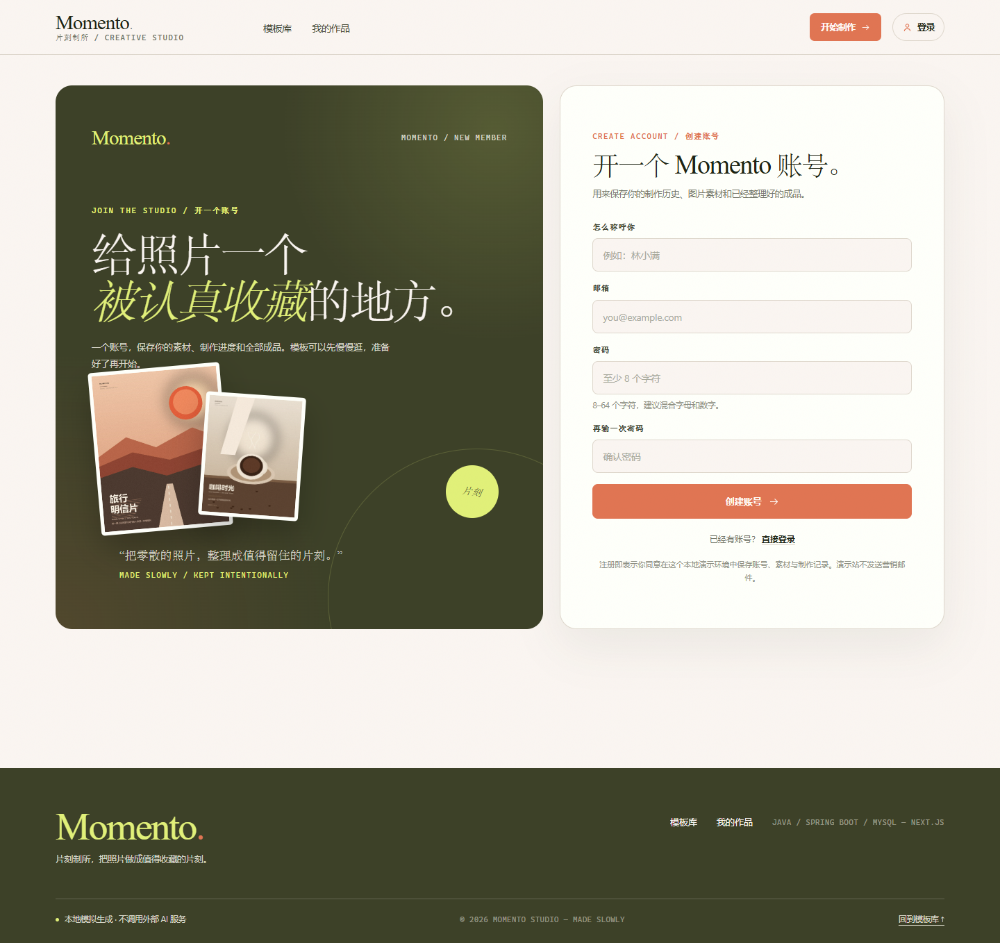 |
| 账号设置（UI-11） | 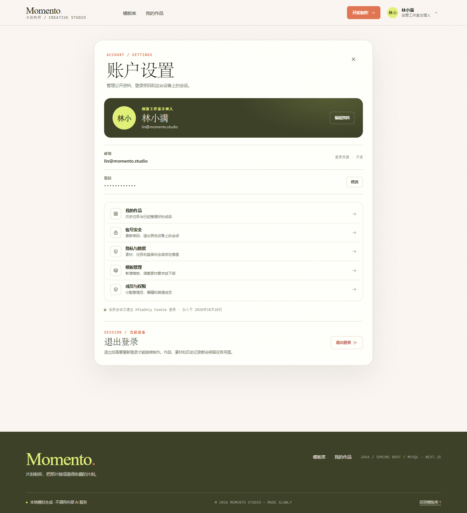 |
| 账号菜单（UI-12） | 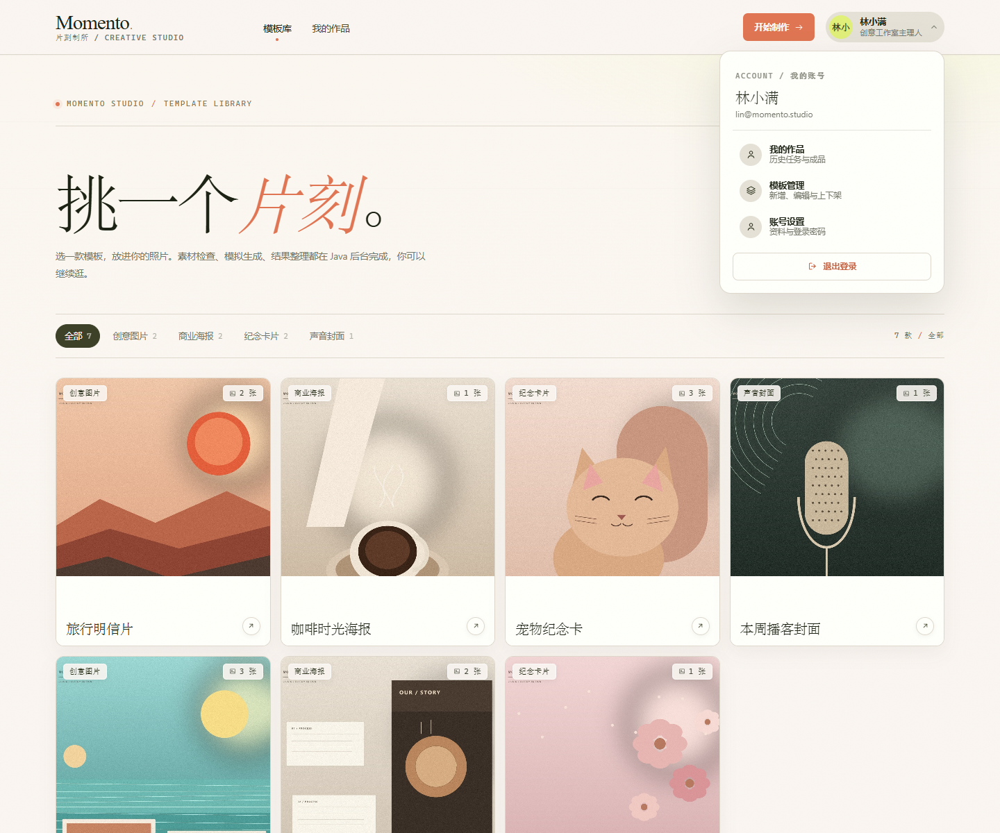 |
| 模板详情与上传位（UI-02） |  |
| 制作中 | 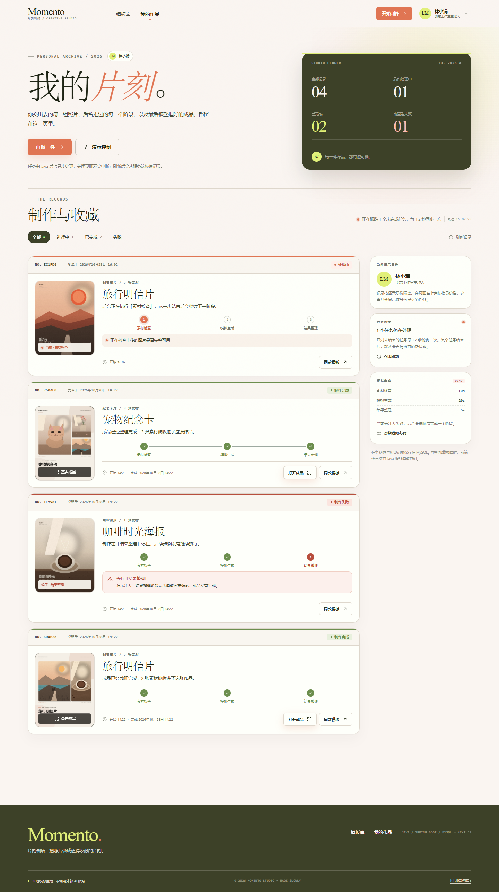 |
| 历史结果与失败 | 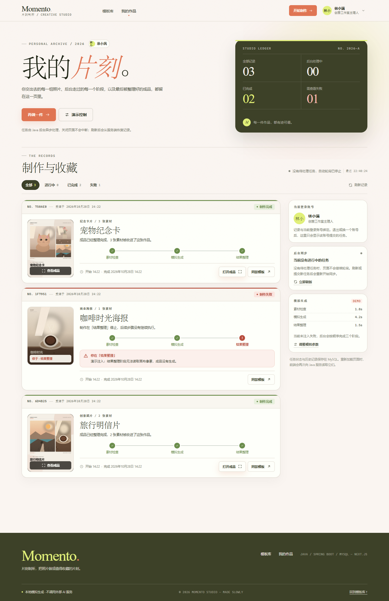 |
| 成品预览 | 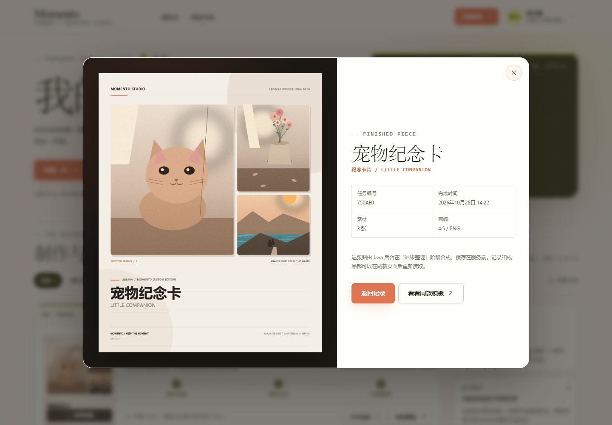 |
| 演示控制 | 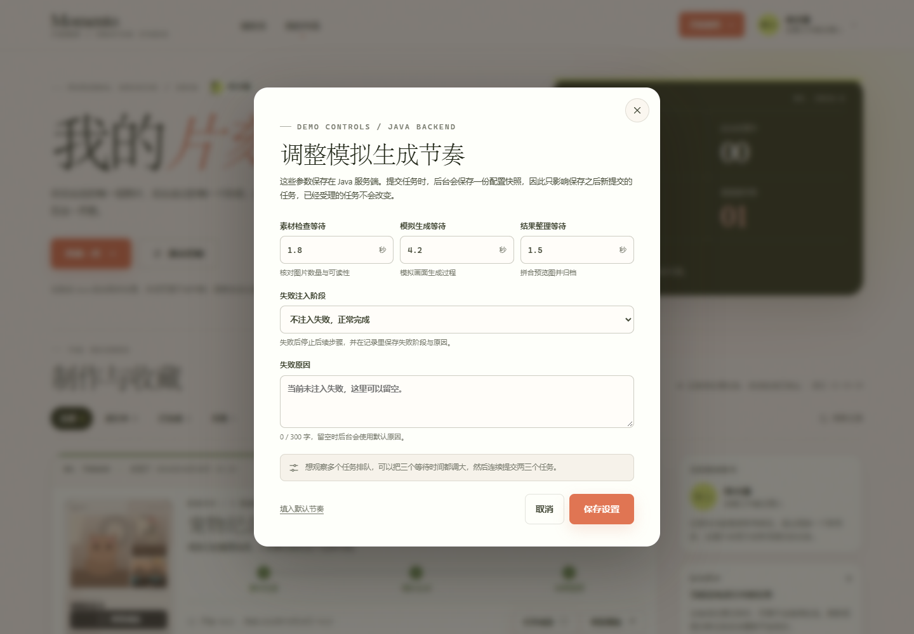 |
| 模板管理（管理员） |  |
| 模板编辑表单 |  |

移动端（390px 视口，截图内为页面实际排版）：

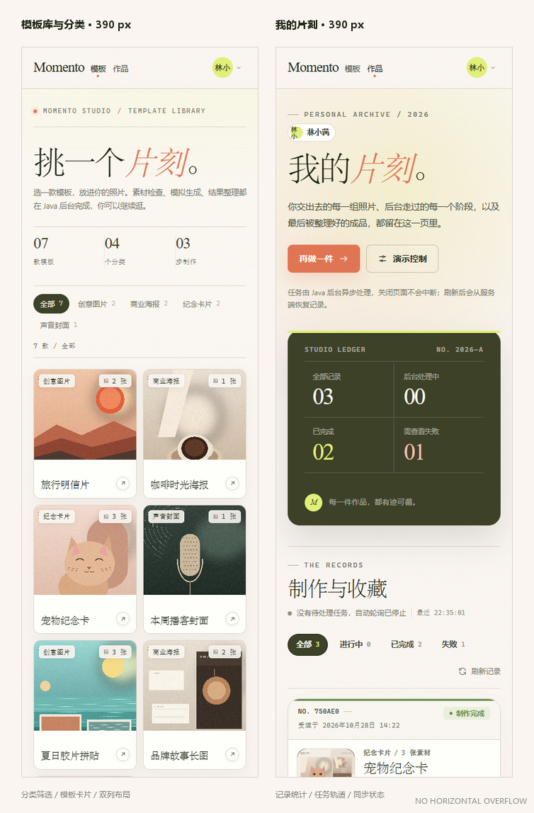

模板库在 390px 下为双列卡片网格，分类筛选自动换行；历史页的任务卡缩略图收窄、侧栏下移。两页均无横向溢出。完整长图：[模板库全页](docs/screenshots/ui-07-mobile-home.png)、[我的片刻全页](docs/screenshots/ui-08-mobile-history.png)。

---

本地模拟生成，不调用外部 AI 服务。示例图片、封面的版权归本项目生成脚本所有，可随项目自由使用。
